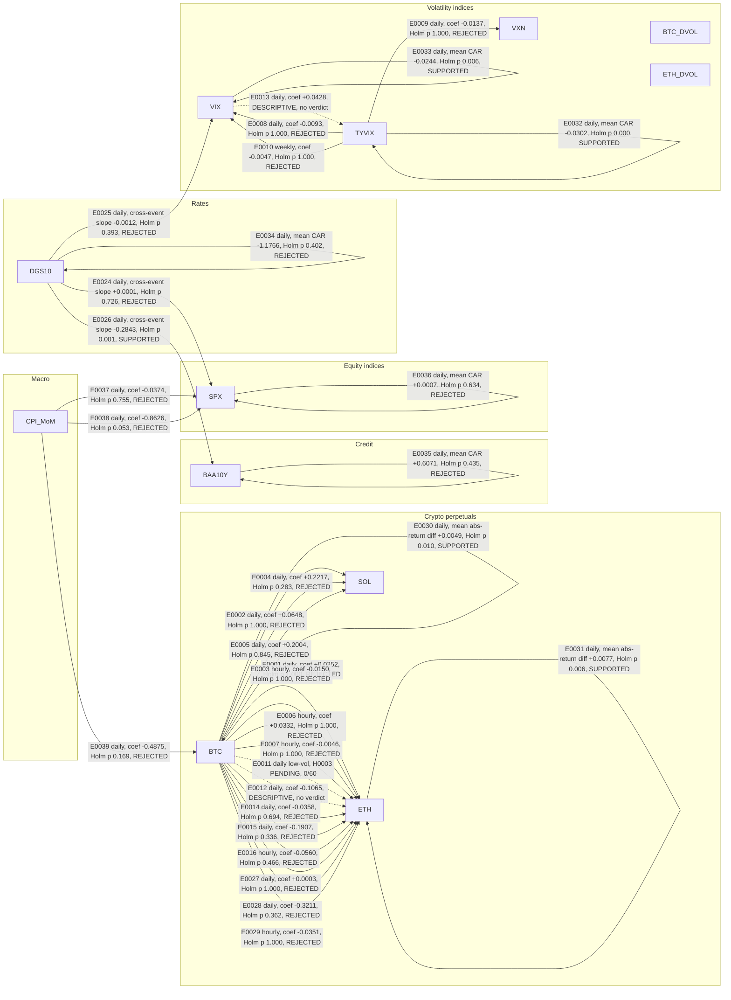

# Market graph and edge registry

The market graph answers one question: **which transmission edges has
myquant tested, what did it find, and what has nobody tested yet?**

Nodes are instruments. Edges are transmission hypotheses that were
preregistered and tested (or preregistered and still pending, or checked
descriptively only). An edge is a hypothesis, not a causal chain — the
architecture's rule from the start. The graph records what was measured,
never what the market "is".

## The headline: transmission is null everywhere tested; macro-window volatility and four event-study findings stand

All 36 family tests across the seven completed studies are in the graph.
No lag-1 transmission was found for any tested pair, frequency or regime
condition:

- BTC → ETH and BTC → SOL perpetuals, daily and 1H, unconditional,
  low-volatility-conditioned, expiry-window-conditioned and
  macro-window-conditioned (studies 001, 002, 004 and 006);
- TYVIX → VIX and TYVIX → VXN, daily and weekly (study 003);
- no expiry-window volatility uplift for BTC or ETH (study 004, H0006);
- no FOMC event-window response for VIX, SPX, DGS10 or BAA10Y, and no
  cross-event rates → equity transmission (study 005);
- no next-day SPX response to the latest published CPI MoM
  (study 007, H0012).

The naive scans agree in both markets: same-day co-movement is strong
(BTC/ETH lag-0 correlation 0.811; TYVIX/VIX 0.362) and the lag-1
correlation is near zero. Information moves within the day, not across
days — in crypto perpetuals and in rates/equity volatility alike.

Six edges rejected their nulls. Two are study 006's H0010 family —
the lab's first supported hypothesis: realized volatility is higher on
macro release days for BTC (ratio 1.2504, Holm p = 0.0098, E0030) and
ETH (ratio 1.2976, Holm p = 0.0058, E0031) — a level effect on known
event days, not a transmission finding and not a trading signal (the
BTC bootstrap interval just includes zero; see the study report).
Two are study 005's secondary tests: rates implied volatility falls
sharply after FOMC statements (TYVIX CAR, E0023), and BAA10Y
event-window CARs co-move with DGS10 CARs across events (E0026) —
though the second is partly mechanical, since the spread contains the
10-year yield by definition. Both study 005 hypotheses were rejected
on their primary tests; the supported edges are live findings with
their caveats on the edge notes, not rescues. Two are study 007's
lagged event-study legs: the TYVIX drop after FOMC statements survives
a one-trading-day FRED publication lag (E0032), and the lagged VIX leg
is significant too, because the day +1 rebound drops out of the lagged
window (E0033).

That pattern — nulls almost everywhere, six narrow findings — is the
graph's most important information right now. It is what stops the next
study from re-testing the same edges, and it is the baseline any future
positive result has to beat.

## How to read the graph

- **Tested edges** (`REJECTED` / `SUPPORTED`) come from a completed
  Holm test family. Lead-lag edges carry their coefficient, standard
  error, raw and Holm-adjusted p-values, partial R², sample window, and
  the trial-level holdout OOS R² and cost gate on the primary edge.
  Mean-comparison, event-study and cross-section edges carry no lag, no
  partial R² and no OOS or cost-gate measurement — those concepts do not
  apply to a level test, an event-window mean or a contemporaneous
  cross-event regression — and their effect sizes (mean ratio,
  standardized mean CAR, cross-section R²) live in the verdict text.
- **Pending edges** (`PENDING`) are preregistered with no trial yet.
  H0003, the forward BTC → ETH daily low-volatility test, runs when 60
  low-volatility forward rows exist (expected around 2027-03). A pending
  edge carries forward-sample counts only — never statistics.
- **Descriptive edges** (`DESCRIPTIVE`) were never in a test family and
  carry no verdict. The Hyperliquid cross-venue check and the VIX → TYVIX
  reverse placebo are recorded so nobody mistakes them for tested edges —
  and so nobody re-runs them as if they were new ideas.
- **Untested candidates** are directed pairs with no tested or pending
  edge. The list is mechanical and includes cross-asset pairs with no
  prior rationale. A candidate is not a hypothesis and not evidence; it
  becomes an edge only through a new preregistered study.

## How the registry is built

The registry (`research/graph/registry.json`) is **generated, never
hand-copied**: `research/graph/build_graph.py` reads the studies' trial
ledgers, preregistrations, the H0003 sample check and the instrument
catalogs, and emits the registry plus the generated section below. The
builder is deterministic and offline — two runs produce byte-identical
output — and it refuses to run if any Holm-family test in a ledger has no
edge spec. See `research/graph/README.md` for the rebuild procedure and
for how to add a new study's edges.

<!-- BEGIN GENERATED: do not edit by hand; regenerate with research/graph/build_graph.py -->

## Current state (generated)

This section is generated by `research/graph/build_graph.py` from the studies' trial ledgers and preregistrations. Do not edit it by hand.

| | count |
| --- | ---: |
| Nodes (instruments) | 12 |
| Tested edges | 36 |
| — of which REJECTED | 30 |
| — of which SUPPORTED | 6 |
| PENDING edges (preregistered, untested) | 1 |
| DESCRIPTIVE checks (no verdict) | 2 |
| Untested candidate pairs | 123 |

**6 of 36 tested edges rejected their null.** The supported edges are the graph's live findings; every other tested edge is a null that stops the next study from re-testing the same configuration.

### Edges

| Edge | Source → Target | Freq | Type | Condition | Hypothesis / trial | Coef | Holm p | Partial R² | Holdout OOS R² | Status |
| --- | --- | --- | --- | --- | --- | ---: | ---: | ---: | ---: | --- |
| E0001 | BTC → ETH | daily | lead-lag | — | H0001 v1 / T0001 | +0.0252 | 1.000 | 0.000109905 | -0.00095 | REJECTED |
| E0002 | BTC → SOL | daily | lead-lag | — | H0001 v1 / T0001 | +0.0648 | 1.000 | 0.000376843 | — | REJECTED |
| E0003 | BTC → ETH | hourly | lead-lag | — | H0001 v1 / T0001 | -0.0150 | 1.000 | 2.51137e-05 | — | REJECTED |
| E0004 | BTC → SOL | daily | lead-lag | low-vol interaction | H0002 v1 / T0002 | +0.2217 | 0.283 | 0.00375922 | +0.01041 | REJECTED |
| E0005 | BTC → SOL | daily | lead-lag | low-vol | H0002 v1 / T0002 | +0.2004 | 0.845 | 0.00421829 | — | REJECTED |
| E0006 | BTC → ETH | hourly | lead-lag | low-vol interaction | H0002 v1 / T0002 | +0.0332 | 1.000 | 0.000151393 | — | REJECTED |
| E0007 | BTC → ETH | hourly | lead-lag | low-vol | H0002 v1 / T0002 | -0.0046 | 1.000 | 2.22713e-06 | — | REJECTED |
| E0008 | TYVIX → VIX | daily | lead-lag | — | H0004 v2 / T0004 | -0.0093 | 1.000 | 3.48403e-05 | -0.00154 | REJECTED |
| E0009 | TYVIX → VXN | daily | lead-lag | — | H0004 v2 / T0004 | -0.0137 | 1.000 | 0.000102649 | — | REJECTED |
| E0010 | TYVIX → VIX | weekly | lead-lag | — | H0004 v2 / T0004 | -0.0047 | 1.000 | 8.59997e-06 | — | REJECTED |
| E0011 | BTC → ETH | daily | lead-lag | low-vol forward | H0003 v1 / — | — | — | — | — | PENDING |
| E0012 | BTC → ETH | daily | lead-lag | low-vol subsample | H0002 v1 / T0002 | -0.1065 | — | 0.0013495 | — | DESCRIPTIVE |
| E0013 | VIX → TYVIX | daily | lead-lag | — | H0004 v2 / T0004 | +0.0428 | — | 0.00176884 | — | DESCRIPTIVE |
| E0014 | BTC → ETH | daily | lead-lag | expiry-window interaction | H0005 v1 / T0005 | -0.0358 | 0.694 | 8.3656e-05 | -0.00772 | REJECTED |
| E0015 | BTC → ETH | daily | lead-lag | expiry-window subsample | H0005 v1 / T0005 | -0.1907 | 0.336 | 0.00909896 | — | REJECTED |
| E0016 | BTC → ETH | hourly | lead-lag | expiry-window interaction | H0005 v1 / T0005 | -0.0560 | 0.466 | 0.000157293 | — | REJECTED |
| E0017 | BTC → BTC | daily | mean-comp | expiry window (mean |r|) | H0006 v1 / T0007 | +0.0000 | 1.000 | — | — | REJECTED |
| E0018 | ETH → ETH | daily | mean-comp | expiry window (mean |r|) | H0006 v1 / T0007 | -0.0011 | 1.000 | — | — | REJECTED |
| E0019 | VIX → VIX | daily | event-study | FOMC event window | H0007 v1 / T0010 | -0.0155 | 0.160 | — | — | REJECTED |
| E0020 | SPX → SPX | daily | event-study | FOMC event window | H0007 v1 / T0010 | +0.0007 | 1.000 | — | — | REJECTED |
| E0021 | DGS10 → DGS10 | daily | event-study | FOMC event window | H0007 v1 / T0010 | -0.9499 | 0.883 | — | — | REJECTED |
| E0022 | BAA10Y → BAA10Y | daily | event-study | FOMC event window | H0007 v1 / T0010 | +0.2717 | 1.000 | — | — | REJECTED |
| E0023 | TYVIX → TYVIX | daily | event-study | FOMC event window | H0007 v1 / T0010 | -0.0381 | 0.000 | — | — | SUPPORTED |
| E0024 | DGS10 → SPX | daily | cross-sect | FOMC cross-event | H0008 v1 / T0009 | +0.0001 | 0.726 | — | — | REJECTED |
| E0025 | DGS10 → VIX | daily | cross-sect | FOMC cross-event | H0008 v1 / T0009 | -0.0012 | 0.393 | — | — | REJECTED |
| E0026 | DGS10 → BAA10Y | daily | cross-sect | FOMC cross-event | H0008 v1 / T0009 | -0.2843 | 0.001 | — | — | SUPPORTED |
| E0027 | BTC → ETH | daily | lead-lag | macro-window interaction | H0009 v1 / T0011 | +0.0003 | 1.000 | 3.08126e-09 | -0.01156 | REJECTED |
| E0028 | BTC → ETH | daily | lead-lag | macro-window subsample | H0009 v1 / T0011 | -0.3211 | 0.362 | 0.0212319 | — | REJECTED |
| E0029 | BTC → ETH | hourly | lead-lag | macro-window interaction | H0009 v1 / T0011 | -0.0351 | 1.000 | 3.1868e-05 | — | REJECTED |
| E0030 | BTC → BTC | daily | mean-comp | macro window (mean |r|) | H0010 v1 / T0012 | +0.0049 | 0.010 | — | — | SUPPORTED |
| E0031 | ETH → ETH | daily | mean-comp | macro window (mean |r|) | H0010 v1 / T0012 | +0.0077 | 0.006 | — | — | SUPPORTED |
| E0032 | TYVIX → TYVIX | daily | event-study | FOMC event window (lagged) | H0011 v1 / T0013 | -0.0302 | 0.000 | — | — | SUPPORTED |
| E0033 | VIX → VIX | daily | event-study | FOMC event window (lagged) | H0011 v1 / T0013 | -0.0244 | 0.006 | — | — | SUPPORTED |
| E0034 | DGS10 → DGS10 | daily | event-study | FOMC event window (lagged) | H0011 v1 / T0013 | -1.1766 | 0.402 | — | — | REJECTED |
| E0035 | BAA10Y → BAA10Y | daily | event-study | FOMC event window (lagged) | H0011 v1 / T0013 | +0.6071 | 0.435 | — | — | REJECTED |
| E0036 | SPX → SPX | daily | event-study | FOMC event window | H0011 v1 / T0013 | +0.0007 | 0.634 | — | — | REJECTED |
| E0037 | CPI_MoM → SPX | daily | lead-lag | CPI step | H0012 v1 / T0015 | -0.0374 | 0.755 | 0.000102239 | -0.00034 | REJECTED |
| E0038 | CPI_MoM → SPX | daily | lead-lag | CPI step (release-day) | H0012 v1 / T0015 | -0.8626 | 0.053 | 0.0602216 | — | REJECTED |
| E0039 | CPI_MoM → BTC | daily | lead-lag | CPI step | H0012 v1 / T0015 | -0.4875 | 0.169 | 0.00216764 | — | REJECTED |

### Edge notes

- **E0001** (REJECTED): Hypothesis H0001 REJECTED (trial T0001): this test did not reject (Holm-adjusted p = 1.000); partial R² 0.000109905 below the 0.005 threshold; holdout OOS incremental R² -0.00095; cost gate fail (net daily edge -0.0872%).
- **E0002** (REJECTED): Hypothesis H0001 REJECTED (trial T0001): this test did not reject (Holm-adjusted p = 1.000, partial R² 0.000376843).
  - Secondary test in the H0001 Holm family (ledger and report); mirrors test (a)'s control structure with the third asset.
- **E0003** (REJECTED): Hypothesis H0001 REJECTED (trial T0001): this test did not reject (Holm-adjusted p = 1.000, partial R² 2.51137e-05).
  - Predeclared 1H robustness test.
- **E0004** (REJECTED): Hypothesis H0002 REJECTED (trial T0002): this test did not reject (Holm-adjusted p = 0.283); partial R² 0.00375922 below the 0.005 threshold; holdout OOS incremental R² +0.01041; cost gate fail (net daily edge -0.0596%).
  - Closest to a signal in the family (raw p = 0.071) but Holm-adjusted p = 0.283 and partial R² below the 0.005 threshold; the direct subsample test A2 (E0005) is clearly null (p = 0.282).
- **E0005** (REJECTED): Hypothesis H0002 REJECTED (trial T0002): this test did not reject (Holm-adjusted p = 0.845, partial R² 0.00421829).
- **E0006** (REJECTED): Hypothesis H0002 REJECTED (trial T0002): this test did not reject (Holm-adjusted p = 1.000, partial R² 0.000151393).
- **E0007** (REJECTED): Hypothesis H0002 REJECTED (trial T0002): this test did not reject (Holm-adjusted p = 1.000, partial R² 2.22713e-06).
- **E0008** (REJECTED): Hypothesis H0004 REJECTED (trial T0004): this test did not reject (Holm-adjusted p = 1.000); partial R² 3.48403e-05 below the 0.005 threshold; holdout OOS incremental R² -0.00154; cost gate informational (gross daily edge +0.3903%, 95% CI includes zero) — no net edge measurable without VIX futures data.
- **E0009** (REJECTED): Hypothesis H0004 REJECTED (trial T0004): this test did not reject (Holm-adjusted p = 1.000, partial R² 0.000102649).
- **E0010** (REJECTED): Hypothesis H0004 REJECTED (trial T0004): this test did not reject (Holm-adjusted p = 1.000, partial R² 8.59997e-06).
  - Predeclared weekly robustness test.
- **E0011** (PENDING): Hypothesis H0003 REGISTERED (v1); no trial has run. The trial runs when 60 low-volatility forward rows exist; sample check 2026-11-18: 0/60 low-volatility rows, not ready.
  - The spec holdout_window starts 2026-11-19T16:00Z but the operative cutoff is fixed parameter forward_window_start = 2026-11-18T16:00Z (one bar earlier); the trial and sample-check scripts use the parameter.
- **E0012** (DESCRIPTIVE): Descriptive only (test C, study 002): Hyperliquid daily BTC→ETH low-volatility subsample. Raw correlation 0.047, factor-controlled coefficient -0.107 (wrong sign). No p-values, not in the test family, no verdict.
  - Labelled rows: 1073 (527 low / 546 high); the ledger's cross_venue.labelled_rows field reads 1072, which is the regression-row count mislabelled — the correct value 1073 comes from the same ledger's regime metrics.
  - Same-period Hyperliquid prices are highly correlated with OKX, so this check excludes venue-specific artefacts only; it cannot cure data snooping.
- **E0013** (DESCRIPTIVE): Descriptive only (reverse placebo, study 003): nominal p = 0.045 is uncorrected and the effect is small (partial R² 0.00176884); treated as noise, not a finding. No verdict.
  - If anything, the nominal signal points equity→rates, the opposite direction from H0004; it must not be cited as evidence of transmission without a fresh preregistration.
- **E0014** (REJECTED): Hypothesis H0005 REJECTED (trial T0005): this test did not reject (Holm-adjusted p = 0.694); partial R² 8.3656e-05 below the 0.005 threshold; holdout OOS incremental R² -0.00772; cost gate fail (net daily edge -0.0437%).
- **E0015** (REJECTED): Hypothesis H0005 REJECTED (trial T0005): this test did not reject (Holm-adjusted p = 0.336, partial R² 0.00909896).
- **E0016** (REJECTED): Hypothesis H0005 REJECTED (trial T0005): this test did not reject (Holm-adjusted p = 0.466, partial R² 0.000157293).
  - Predeclared 1H robustness test.
- **E0017** (REJECTED): Hypothesis H0006 REJECTED (trial T0007): this test did not reject (Holm-adjusted p = 1.000); window/non-window mean |log return| ratio 1.0001 below the 1.15 threshold; mean difference +0.000001 (95% block-bootstrap CI [-0.004740, +0.005052]). No OOS or cost-gate criterion: level comparison, not a forecast.
  - Mean-comparison edge, not a transmission edge: it tests whether BTC realized volatility differs inside the expiry window. Effect size is the window/non-window mean |log return| ratio (threshold 1.15).
- **E0018** (REJECTED): Hypothesis H0006 REJECTED (trial T0007): this test did not reject (Holm-adjusted p = 1.000); window/non-window mean |log return| ratio 0.9590.
  - Mean-comparison edge, not a transmission edge: it tests whether ETH realized volatility differs inside the expiry window.
- **E0019** (REJECTED): Hypothesis H0007 REJECTED (trial T0010): this test did not reject (Holm-adjusted p = 0.160); standardized mean CAR -0.1507 above the -0.30 threshold; mean CAR -0.015517 over [0,+1] (n = 135 events). No OOS or cost-gate criterion: event study, not a forecast.
  - Primary test of H0007: the post-announcement volatility drop for equity vol. The TYVIX leg (E0023) rejected strongly; the VIX drop is much weaker.
- **E0020** (REJECTED): Hypothesis H0007 REJECTED (trial T0010): this test did not reject (Holm-adjusted p = 1.000); standardized mean CAR 0.0409.
- **E0021** (REJECTED): Hypothesis H0007 REJECTED (trial T0010): this test did not reject (Holm-adjusted p = 0.883); standardized mean CAR -0.0902.
  - CAR in basis points of the 10-year yield level change.
- **E0022** (REJECTED): Hypothesis H0007 REJECTED (trial T0010): this test did not reject (Holm-adjusted p = 1.000); standardized mean CAR 0.0460.
  - CAR in basis points of the BAA-10Y spread level change.
- **E0023** (SUPPORTED): Hypothesis H0007 REJECTED (trial T0010): this test rejected (Holm-adjusted p = 0.000); standardized mean CAR -0.4829; the hypothesis verdict is decided by the primary test (E0019).
  - Rates implied volatility falls sharply after FOMC statements; the effect is present in all three policy-cycle splits (descriptive).
- **E0024** (REJECTED): Hypothesis H0008 REJECTED (trial T0009): this test did not reject (Holm-adjusted p = 0.726); R² 0.0057 below the 0.05 threshold; split-half replication failed (first-half slope +0.000045, second-half slope +0.000316). No OOS or cost-gate criterion: event study, not a forecast.
  - Primary test of H0008. The DGS10 CAR is a proxy for the policy surprise, not the surprise itself: no free federal funds futures surprise series exists.
  - Split-half replication (chronological, 67/68 events) is a verdict criterion; both halves' slopes were positive.
- **E0025** (REJECTED): Hypothesis H0008 REJECTED (trial T0009): this test did not reject (Holm-adjusted p = 0.393); R² 0.0159.
- **E0026** (SUPPORTED): Hypothesis H0008 REJECTED (trial T0009): this test rejected (Holm-adjusted p = 0.001); R² 0.2570; the hypothesis verdict is decided by the primary test (E0024).
  - BAA10Y contains -DGS10 by definition (spread = BAA yield minus 10-year yield), so the slope is (beta_BAA - 1): BAA yields move about 72% as much as Treasury yields in the event window. The slope and R-squared are not comparable to a clean two-asset transmission test.
- **E0027** (REJECTED): Hypothesis H0009 REJECTED (trial T0011): this test did not reject (Holm-adjusted p = 1.000); partial R² 3.08126e-09 below the 0.005 threshold; holdout OOS incremental R² -0.01156; cost gate fail (net daily edge -0.0217%).
- **E0028** (REJECTED): Hypothesis H0009 REJECTED (trial T0011): this test did not reject (Holm-adjusted p = 0.362, partial R² 0.0212319).
- **E0029** (REJECTED): Hypothesis H0009 REJECTED (trial T0011): this test did not reject (Holm-adjusted p = 1.000, partial R² 3.1868e-05).
  - Predeclared 1H robustness test.
- **E0030** (SUPPORTED): Hypothesis H0010 SUPPORTED (trial T0012): this test rejected (Holm-adjusted p = 0.010); window/non-window mean |log return| ratio 1.2504 at or above the 1.15 threshold; mean difference +0.004911 (95% block-bootstrap CI [-0.000224, +0.010362]). No OOS or cost-gate criterion: level comparison, not a forecast.
  - Mean-comparison edge, not a transmission edge: it tests whether BTC realized volatility differs inside the macro window. Effect size is the window/non-window mean |log return| ratio (threshold 1.15).
- **E0031** (SUPPORTED): Hypothesis H0010 SUPPORTED (trial T0012): this test rejected (Holm-adjusted p = 0.006); window/non-window mean |log return| ratio 1.2976; the hypothesis verdict is decided by the primary test (E0030).
  - Mean-comparison edge, not a transmission edge: it tests whether ETH realized volatility differs inside the macro window.
- **E0032** (SUPPORTED): Hypothesis H0011 SUPPORTED (trial T0013): this test rejected (Holm-adjusted p = 0.000); standardized mean CAR -0.5157 at or below the -0.30 threshold; mean CAR -0.030216 over [0,+1] (n = 135 events). No OOS or cost-gate criterion: event study, not a forecast.
  - Primary test of H0011. The TYVIX drop is concentrated on day 0 (descriptive per-day AR: day 0 -0.0336, day +1 -0.0045), so the lagged window keeps most of the effect.
- **E0033** (SUPPORTED): Hypothesis H0011 SUPPORTED (trial T0013): this test rejected (Holm-adjusted p = 0.006); standardized mean CAR -0.2561; the hypothesis verdict is decided by the primary test (E0032).
  - Significant under the lag while the unlagged VIX test was not (study 005: Holm p = 0.160): the day +1 rebound (+0.0098) drops out of the lagged window, leaving the day 0 drop (-0.0254) alone.
- **E0034** (REJECTED): Hypothesis H0011 SUPPORTED (trial T0013): this test did not reject (Holm-adjusted p = 0.402); standardized mean CAR -0.1289; the hypothesis verdict is decided by the primary test (E0032).
  - CAR in basis points of the 10-year yield level change.
- **E0035** (REJECTED): Hypothesis H0011 SUPPORTED (trial T0013): this test did not reject (Holm-adjusted p = 0.435); standardized mean CAR 0.1061; the hypothesis verdict is decided by the primary test (E0032).
  - CAR in basis points of the BAA-10Y spread level change.
- **E0036** (REJECTED): Hypothesis H0011 SUPPORTED (trial T0013): this test did not reject (Holm-adjusted p = 0.634); standardized mean CAR 0.0409; the hypothesis verdict is decided by the primary test (E0032).
  - Unlagged control (Yahoo SPX is not shifted): reproduces study 005's SPX CAR exactly (+0.000669, p = 0.634), as the trial's machinery guard requires.
- **E0037** (REJECTED): Hypothesis H0012 REJECTED (trial T0015): this test did not reject (Holm-adjusted p = 0.755); partial R² 0.000102239 below the 0.005 threshold; holdout OOS incremental R² -0.00034; cost gate informational (gross daily edge +0.0293%, 95% CI includes zero) — no net edge measurable without a tradable SPX price series.
  - Primary test of H0012. HAC max lag 21 is preregistered: the step predictor's run length is about 21 trading days.
  - The step takes only 69 distinct values over 2021-2026; the 1,468 daily rows are not the effective sample size.
- **E0038** (REJECTED): Hypothesis H0012 REJECTED (trial T0015): this test did not reject (Holm-adjusted p = 0.053, partial R² 0.0602216).
  - Closest read in the family (raw p = 0.018, Holm p = 0.053, partial R² 0.060) but it does not survive the family correction; recorded as hypothesis-generating only.
- **E0039** (REJECTED): Hypothesis H0012 REJECTED (trial T0015): this test did not reject (Holm-adjusted p = 0.169, partial R² 0.00216764).
  - Predeclared BTC robustness test.

### Diagram

Solid arrows are tested edges; dashed arrows are pending or descriptive. Labels show the edge id, frequency, coefficient, Holm-adjusted p-value (tested edges) and status. Mean-comparison and event-study edges are self-loops labelled with the mean difference and the mean CAR respectively; they are within-instrument level tests, not transmission claims. Cross-section edges are directed but contemporaneous (both CARs over the same event window), not lead-lag claims.

### Untested candidates

There are 123 directed pairs with no tested or pending edge. They are **untested candidates, not evidence**: the list is mechanical (every ordered pair of graph nodes minus the tested pairs) and includes cross-asset pairs with no prior rationale. A candidate becomes an edge only through a new preregistered study.

| Market-group pair | untested pairs |
| --- | ---: |
| credit ↔ crypto | 6 |
| credit ↔ index | 2 |
| credit ↔ macro | 2 |
| credit ↔ rates | 1 |
| credit ↔ volatility | 10 |
| crypto ↔ crypto | 4 |
| crypto ↔ index | 6 |
| crypto ↔ macro | 5 |
| crypto ↔ rates | 6 |
| crypto ↔ volatility | 30 |
| index ↔ macro | 1 |
| index ↔ rates | 1 |
| index ↔ volatility | 10 |
| macro ↔ rates | 2 |
| macro ↔ volatility | 10 |
| rates ↔ volatility | 9 |
| volatility ↔ volatility | 18 |

Full candidate list (generated)

- BAA10Y → BTC
- BAA10Y → ETH
- BAA10Y → SOL
- BAA10Y → BTC_DVOL
- BAA10Y → ETH_DVOL
- BAA10Y → SPX
- BAA10Y → TYVIX
- BAA10Y → VIX
- BAA10Y → VXN
- BAA10Y → CPI_MoM
- BAA10Y → DGS10
- BTC → BAA10Y
- BTC → BTC_DVOL
- BTC → ETH_DVOL
- BTC → SPX
- BTC → TYVIX
- BTC → VIX
- BTC → VXN
- BTC → CPI_MoM
- BTC → DGS10
- ETH → BAA10Y
- ETH → BTC
- ETH → SOL
- ETH → BTC_DVOL
- ETH → ETH_DVOL
- ETH → SPX
- ETH → TYVIX
- ETH → VIX
- ETH → VXN
- ETH → CPI_MoM
- ETH → DGS10
- SOL → BAA10Y
- SOL → BTC
- SOL → ETH
- SOL → BTC_DVOL
- SOL → ETH_DVOL
- SOL → SPX
- SOL → TYVIX
- SOL → VIX
- SOL → VXN
- SOL → CPI_MoM
- SOL → DGS10
- BTC_DVOL → BAA10Y
- BTC_DVOL → BTC
- BTC_DVOL → ETH
- BTC_DVOL → SOL
- BTC_DVOL → ETH_DVOL
- BTC_DVOL → SPX
- BTC_DVOL → TYVIX
- BTC_DVOL → VIX
- BTC_DVOL → VXN
- BTC_DVOL → CPI_MoM
- BTC_DVOL → DGS10
- ETH_DVOL → BAA10Y
- ETH_DVOL → BTC
- ETH_DVOL → ETH
- ETH_DVOL → SOL
- ETH_DVOL → BTC_DVOL
- ETH_DVOL → SPX
- ETH_DVOL → TYVIX
- ETH_DVOL → VIX
- ETH_DVOL → VXN
- ETH_DVOL → CPI_MoM
- ETH_DVOL → DGS10
- SPX → BAA10Y
- SPX → BTC
- SPX → ETH
- SPX → SOL
- SPX → BTC_DVOL
- SPX → ETH_DVOL
- SPX → TYVIX
- SPX → VIX
- SPX → VXN
- SPX → CPI_MoM
- SPX → DGS10
- TYVIX → BAA10Y
- TYVIX → BTC
- TYVIX → ETH
- TYVIX → SOL
- TYVIX → BTC_DVOL
- TYVIX → ETH_DVOL
- TYVIX → SPX
- TYVIX → CPI_MoM
- TYVIX → DGS10
- VIX → BAA10Y
- VIX → BTC
- VIX → ETH
- VIX → SOL
- VIX → BTC_DVOL
- VIX → ETH_DVOL
- VIX → SPX
- VIX → TYVIX — Descriptive reverse placebo (E0013, study 003): nominal p = 0.045, partial R² 0.0018, treated as noise. No family test has been run on this pair.
- VIX → VXN
- VIX → CPI_MoM
- VIX → DGS10
- VXN → BAA10Y
- VXN → BTC
- VXN → ETH
- VXN → SOL
- VXN → BTC_DVOL
- VXN → ETH_DVOL
- VXN → SPX
- VXN → TYVIX
- VXN → VIX
- VXN → CPI_MoM
- VXN → DGS10
- CPI_MoM → BAA10Y
- CPI_MoM → ETH
- CPI_MoM → SOL
- CPI_MoM → BTC_DVOL
- CPI_MoM → ETH_DVOL
- CPI_MoM → TYVIX
- CPI_MoM → VIX
- CPI_MoM → VXN
- CPI_MoM → DGS10
- DGS10 → BTC
- DGS10 → ETH
- DGS10 → SOL
- DGS10 → BTC_DVOL
- DGS10 → ETH_DVOL
- DGS10 → TYVIX
- DGS10 → VXN
- DGS10 → CPI_MoM

### Provenance

Every number above traces to one of these ledger records. Re-run the builder to verify: it re-reads the ledgers and refuses to run if a family test is unmapped.

| Study | Trial | Ledger record | Preregistration |
| --- | --- | --- | --- |
| btc-eth-001 | T0001 | `7cf678cdaffa` | `1938d1bd8e5a` |
| lowvol-002 | T0002 | `1240f8d7a520` | `08b43b7d4769` |
| lowvol-002 | — (pending) | `—` | `488dbf031f23` |
| move-vix-003 | T0004 | `77f2789ca1ea` | `c3923f5a530e` |
| options-expiry-004 | T0005 | `644b4221b246` | `5c9d73af2bd7` |
| options-expiry-004 | T0007 | `69d75c944b75` | `0c48d2ac4fc3` |
| fomc-event-study-005 | T0010 | `4942fb6135ac` | `c9a278bf1371` |
| fomc-event-study-005 | T0009 | `c82c6182f15f` | `f76d5b607567` |
| macro-windows-006 | T0011 | `af641748117f` | `0e1ec3d3768c` |
| macro-windows-006 | T0012 | `4b0dd1cce4fb` | `a10ddda95531` |
| publication-lag-007 | T0013 | `a4852f550c5e` | `b1d626ddffb3` |
| publication-lag-007 | T0015 | `6d757217ecab` | `8526ef1ce9d5` |

Registry content hash: `3d0515bd4fa1f7c3922d10a4e1cbb805b4cba3e6ccbd630f26b6973704ec4ae0`
<!-- END GENERATED -->

## Limitations

- **The graph is a record of tests, not a map of market structure.**
  Twenty-one nulls say transmission was not found where it was looked
  for; they say nothing about untested pairs, other horizons, or
  nonlinear effects. The two supported edges are narrow findings (one
  event-window volatility response, one partly mechanical spread
  association), not a market structure.
- **Coverage is narrow.** Eleven nodes across five asset classes
  (crypto perpetuals; crypto and equity volatility indices; US rates,
  credit and the S&P 500 index), one lag (lag 1) for the lead-lag
  edges, linear tests only. FX, commodities, single-name options and
  intraday horizons below 1H are absent.
- **The TYVIX sample ends in May 2020.** The rates-volatility edges
  exclude the post-2020 hiking cycle — the largest rates-volatility
  regime in decades.
- **Descriptive checks are not tests.** The reverse placebo's nominal
  p = 0.045 is uncorrected and small; the cross-venue check shares
  OKX's prices almost exactly. Both are recorded as descriptive for
  exactly that reason.
- **Costs are trial-level.** Holdout OOS R² and the cost gate attach to
  each trial's primary edge only; other edges in the same trial do not
  have their own OOS or cost measurements.
